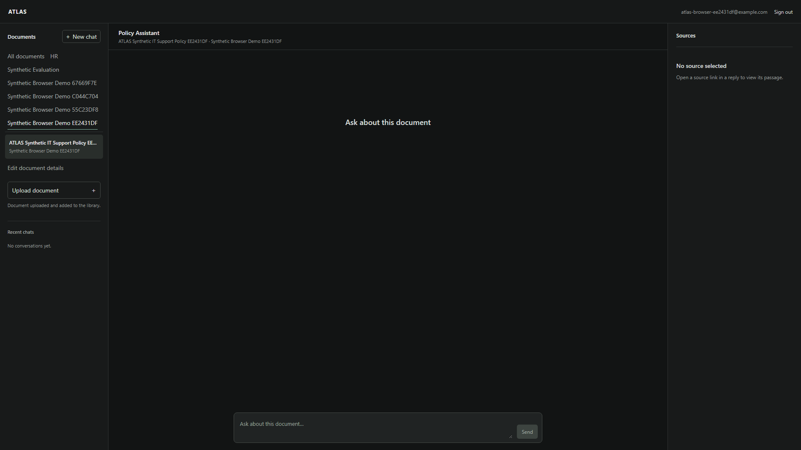
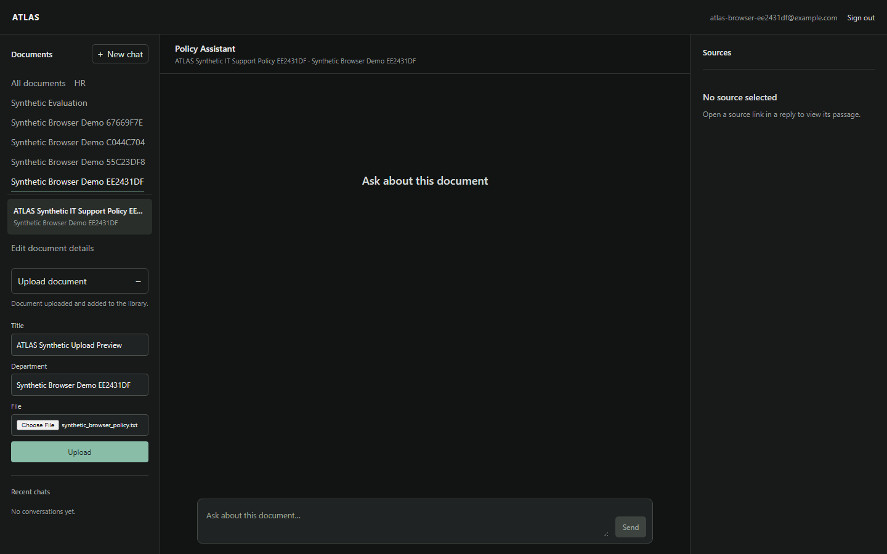
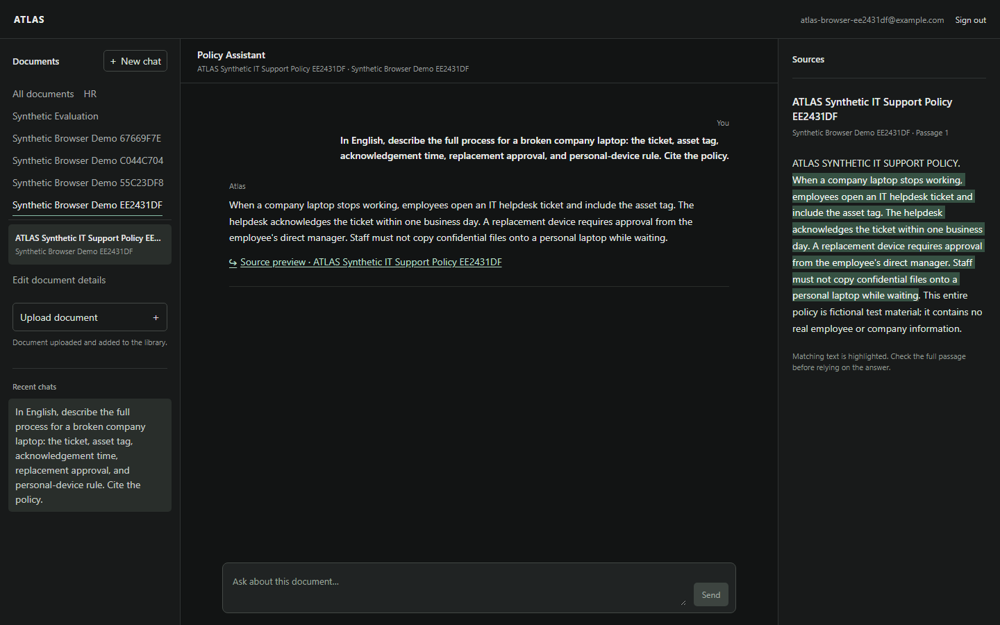
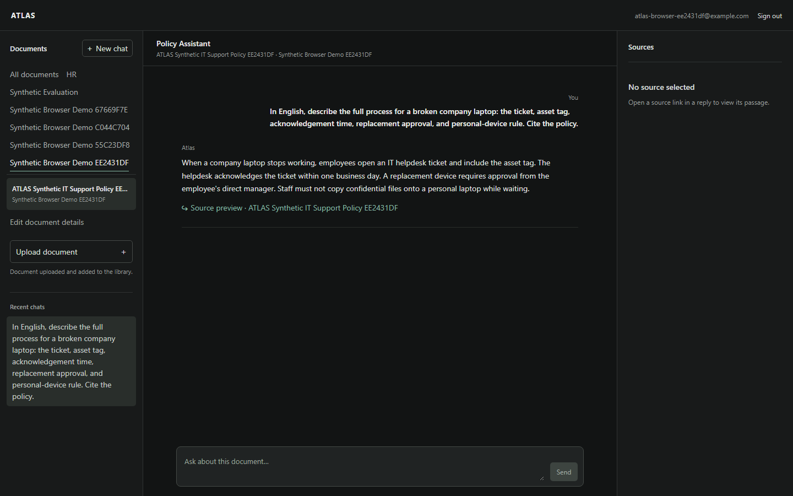
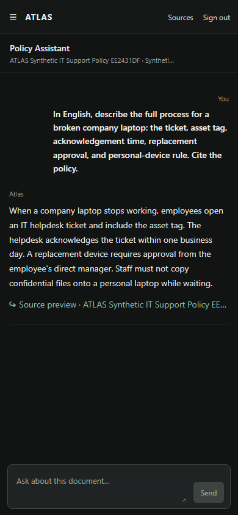
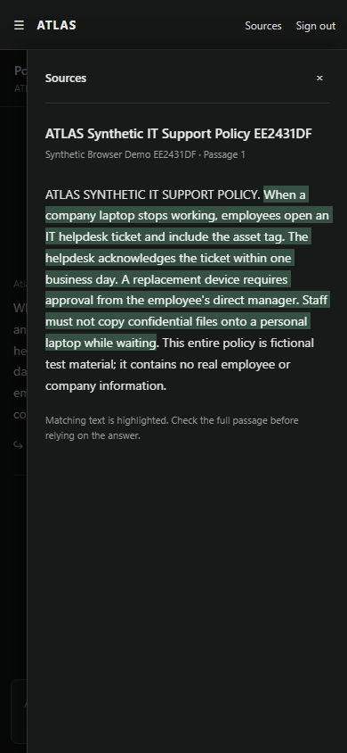
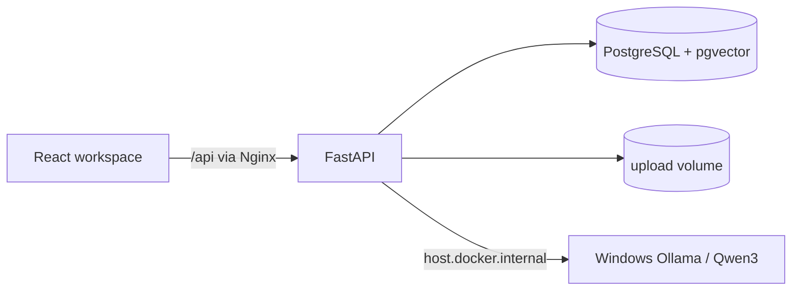

# ATLAS — Enterprise AI Knowledge Assistant

ATLAS is a local, document-scoped retrieval-augmented knowledge assistant. An administrator uploads a PDF, DOCX or TXT document, selects it in a React workspace and asks questions. The backend retrieves passages from PostgreSQL/pgvector, streams a response from a host Ollama Qwen3 model, and links cited chunks to an Evidence Viewer. Chat history belongs to the authenticated user.

This repository documents a working local deployment and its limits. It is not a public production deployment or a claim of guaranteed factual accuracy.

## What is implemented

- Bounded PDF, DOCX and UTF-8 TXT ingestion, text extraction, smart chunking and multilingual E5 embeddings.
- Document-scoped cosine retrieval from pgvector and Qwen3 answers with retrieved-source ID validation.
- SSE token streaming, per-user conversation history, and a React source viewer that shows the full cited passage.
- JWT login, admin-only document/RAG routes, conversation ownership checks, same-origin Nginx proxy and non-root containers.
- Docker health endpoints, persistent volumes, backup/isolated-restore scripts and separate backend/frontend GitHub Actions jobs.

## Demo and screenshots

These are real screenshots from an isolated Playwright Chromium context connected to the local Docker application and Windows Ollama. The account and policy are fictional. The [repeatable browser test](frontend/e2e/atlas-browser.e2e.mjs) covers login, the browser file chooser, upload, Qwen3 streaming, citation inspection, history, mobile panels and logout; the [demo scenario](docs/demo.md) gives the same flow to a human reviewer.

**Desktop workspace · 1920 × 1080**



**Document library and browser file chooser · 1440 × 900**



**English Qwen3 answer and source link · 1440 × 900**


**Citation opened in Evidence Viewer · 1440 × 900**



**Conversation reopened from Recent chats · 1440 × 900**



**Mobile workspace and Evidence Viewer · 390 × 844**





Additional real captures include the [1440 × 900 workspace](docs/assets/desktop-workspace-1440x900.png), [visible answer before SSE completion](docs/assets/desktop-streaming-before-done-1440x900.png), and [mobile library](docs/assets/mobile-library-390x844.png).

## Architecture



Upload → format validation → text extraction → approximately 500-character smart chunks → `intfloat/multilingual-e5-small` passage embeddings → PostgreSQL `VECTOR(384)` records. For a question, ATLAS embeds the query, searches only the selected document, constructs a prompt with untrusted JSON source excerpts, calls `qwen3:4b-instruct` through Ollama, validates that cited chunk IDs were retrieved, and streams the answer. Opening a citation fetches the stored passage; the UI may highlight an exact overlap to help the reader review it. Citation IDs do not prove semantic correctness. See the [architecture](docs/architecture.md) and [engineering decisions](docs/engineering-decisions.md).

## Stack

| Layer | Technology |
| --- | --- |
| API, ORM, migrations | Python 3.10, FastAPI, SQLAlchemy, Alembic |
| Database and search | PostgreSQL 18, pgvector, cosine distance, HNSW index |
| Embeddings | Sentence Transformers, `intfloat/multilingual-e5-small` |
| Generation | Windows host Ollama, `qwen3:4b-instruct` |
| Web | React 19, TypeScript, Vite, Nginx |
| Testing/CI | pytest, Vitest, ESLint, TypeScript, GitHub Actions |

## Local Docker Compose setup

Requirements: Docker Desktop with Compose; a Windows host Ollama service reachable by the backend at `host.docker.internal:11434`; the `qwen3:4b-instruct` model installed in Ollama; enough disk for the Python image, embedding model cache and PostgreSQL volume. CPU inference may be slow. This exact Compose host bridge was validated on Windows; another OS requires checking the Ollama address and host networking.

1. Create **untracked** `.env.compose` in the repository root with unique strong values:

   ```dotenv
   ATLAS_DB_PASSWORD=replace_with_a_unique_long_password
   JWT_SECRET_KEY=replace_with_a_unique_long_random_secret
   ```

2. Start Ollama and pull the configured model on the host:

   ```powershell
   ollama pull qwen3:4b-instruct
   ```

3. On a **new, empty** Compose database, build, start PostgreSQL, apply migrations, then start all services:

   ```powershell
   docker compose --env-file .env.compose build backend frontend
   docker compose --env-file .env.compose up -d db
   docker compose --env-file .env.compose run --rm backend alembic upgrade head
   docker compose --env-file .env.compose up -d
   .\scripts\diagnostics.ps1
   ```

4. Open `http://127.0.0.1:8088`. The backend and PostgreSQL have no published host ports; Nginx proxies `/api/` on the same origin.

5. Register an account through `POST /api/users/register` (for example, the API docs at `http://127.0.0.1:8088/api/docs`). Registration creates an **employee**; the frontend may show the workspace shell, but document and chat API requests will be denied. A trusted operator must grant the first admin role in the Compose database. There is currently no self-service admin bootstrap screen or management command. Confirm you are operating on `atlas_compose_db` before changing a role; never run this against a separate Windows PostgreSQL installation.

   ```powershell
   docker compose --env-file .env.compose exec -T db psql -U atlas_compose_user -d atlas_compose_db -c "SELECT current_database();"
   docker compose --env-file .env.compose exec -T db psql -U atlas_compose_user -d atlas_compose_db -c "UPDATE users SET role='admin' WHERE email='replace-with-registered-email@example.com' AND role='employee';"
   ```

   Replace the example email, verify the first command names `atlas_compose_db` and verify the update reports exactly one row. Then sign in with that registered account.

For an existing installation, follow the backup and migration procedure in [operations.md](docs/operations.md). Do not reset or remove named volumes as a shortcut.

### Manual development setup

The Docker path above is the validated local deployment. Manual mode requires Python 3.10, Node.js 22, PostgreSQL 18 with `vector`, and Ollama. Copy `backend/.env.example` to `backend/.env` and set local database/JWT values. Install `backend/requirements-dev.txt`, apply Alembic migrations from `backend`, run `uvicorn app.main:app`, then run `npm ci` and `npm run dev` from `frontend`. Vite uses local development CORS origins. Models are downloaded separately; they are not committed.

## Security model

JWT bearer auth protects the API; document upload, read, search, ask, sources and chat are admin-only. Conversation reads and streams additionally check `user_id`, so one admin cannot open another admin's history. Uploaded document passages are untrusted data in the RAG prompt. File, parser, page, expansion and extracted-text limits reduce upload risk. The private Compose deployment binds Nginx to loopback; PostgreSQL stays internal. Secrets live in ignored environment files, not source code. See [architecture](docs/architecture.md) for exact boundaries and [validation](docs/validation.md) for tested checks.

## Tests, evaluation and CI

From `backend`: `..\.venv\Scripts\python.exe -m pytest -q test` in the validated Windows workspace, or `python -m pytest -q test` in a fresh Python environment with `requirements-dev.txt`. From `frontend`: `npm ci`, `npm test`, `npm run lint`, and `npm run build`.

For the real local browser acceptance test, start Compose and host Ollama, then from `frontend` run `npx playwright install chromium` once and `npm run test:e2e`. The test uses a fresh managed Chromium context and the live `/api` endpoints; it does not mock network responses. It requires Docker CLI access, creates a new synthetic admin and document in the **Docker** database on each run, and writes real screenshots to `docs/assets/`. It is separate from standard GitHub CI because the runner does not have this Windows Ollama service.

[GitHub Actions CI](.github/workflows/ci.yml) applies migrations against an isolated pgvector PostgreSQL service, runs backend tests, and separately runs frontend tests, lint and build. It mocks embedding/Ollama behavior; [local validation](docs/validation.md) covers real Qwen3 and Compose integration.

The [synthetic evaluation](docs/evaluation.md) has 24 predefined questions over a nine-chunk fictional policy. The measured mean Recall@3 is **0.984 over 21 questions with labeled relevant chunks**; manual review passed 7 of 8 prespecified model-answer examples. These small fixture results are not a production accuracy estimate. Reproduce them with `python backend/scripts/evaluate_final.py` while the Compose stack is running; each run adds a synthetic user and document to that local Docker database.

## Operations and limitations

See [operations.md](docs/operations.md) for health checks, backup, isolated restore and recovery, [validation.md](docs/validation.md) for final acceptance evidence, and [portfolio.md](docs/portfolio.md) for honest project summaries.

Current limits include: admin-only shared corpus without per-document ACL; no refresh tokens, MFA or rate limiting; synchronous ingestion; no active retrieval similarity threshold; citation ID checks without semantic proof; local Ollama host dependency; no high-availability or public TLS design.
