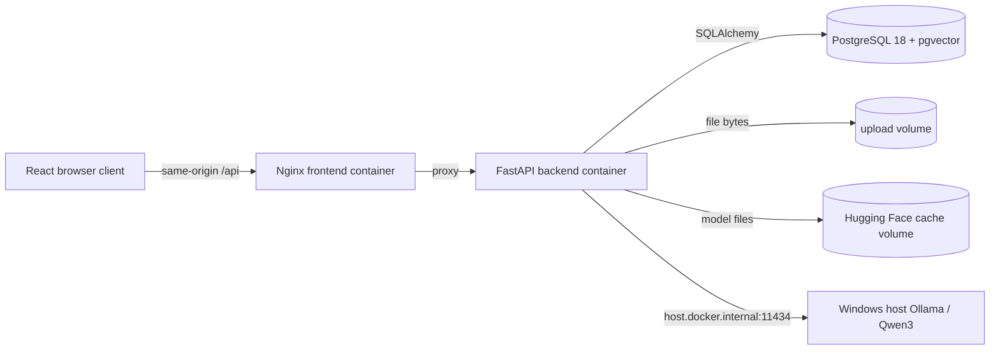
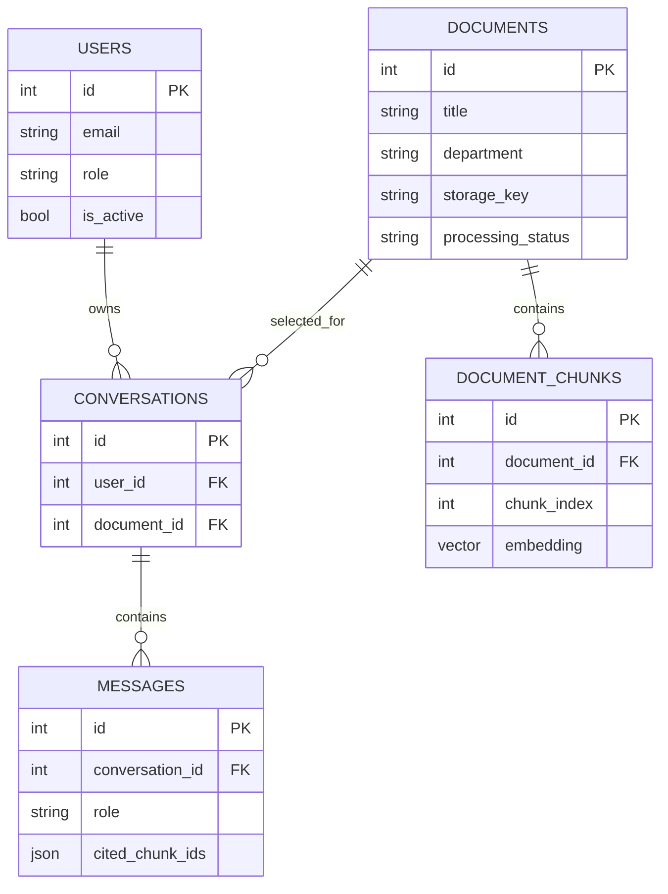
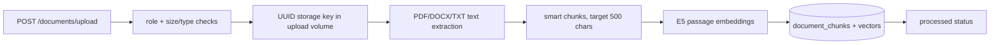
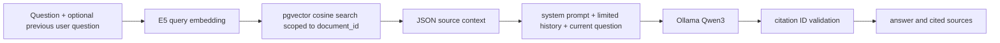
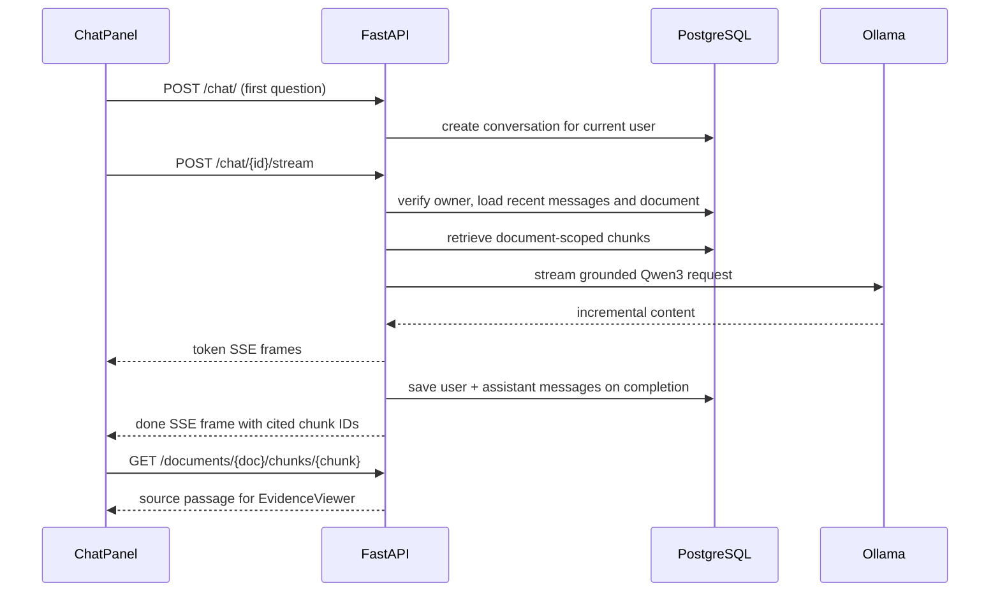

# ATLAS architecture

This document describes the code at the final Lesson 132 delivery. It distinguishes implemented behavior from deployment assumptions. ATLAS is a local, document-scoped RAG application, not a general enterprise search service.

## System and deployment

`compose.yaml` defines `db`, `backend`, and `frontend`. Only Nginx publishes a host port, bound to `127.0.0.1:8088`. PostgreSQL and FastAPI are internal to the Compose network. Nginx forwards `/api/` to FastAPI and disables proxy buffering for SSE. The backend and frontend run as non-root users. Persistent named volumes hold PostgreSQL data, uploaded files, and the embedding model cache. Ollama is outside Compose; the configured model is `qwen3:4b-instruct` on the Windows host. The embedding model is `intfloat/multilingual-e5-small` (384 dimensions), loaded by Sentence Transformers in the backend.

## Frontend

`frontend/src/App.tsx` keeps the login session in React memory. `LoginForm` obtains a bearer token and `GET /users/me`; `Workspace` owns selected document, conversation, messages, source, mobile panels, and streaming state. `WorkspaceSidebar` presents documents, upload/edit/delete controls, filters and recent conversations. `ChatPanel` creates a conversation on the first send and renders streamed text. `EvidenceViewer` loads the selected source passage and optionally highlights an exact text overlap, using `utils/evidence.ts`. The `api/` modules send bearer requests and parse SSE frames. The frontend does not persist the token across reloads.

## Backend layers and database

`app/main.py` wires routers and exception handlers. `app/routers/` validates HTTP input and enforces authentication. `app/services/` contains upload, parsing, chunking, embedding, retrieval, RAG, chat and citation behavior. `app/repositories/` implements SQLAlchemy access. `app/models/` defines persisted entities; `app/schemas/` defines request/response contracts. Alembic migrations under `backend/alembic/versions` manage the schema; current head is `c49f5e82a731`.

The `document_chunks.embedding` column uses pgvector `VECTOR(384)` on PostgreSQL; an HNSW index is added by migrations. The citation IDs in `messages.cited_chunk_ids` are JSON values, not foreign keys. Documents have no per-user owner or ACL. Current policy gives admins access to the shared document corpus; employees cannot access document, search, ask or chat routes. This is a product access model, not document-level sharing.

## Document ingestion

The upload route requires an admin. `FileUploadService` limits input to 10 MiB; checks extension, MIME declaration and actual PDF/DOCX/TXT structure; rejects encrypted or malformed PDFs, malformed DOCX ZIPs and invalid UTF-8 TXT; and caps PDF pages, DOCX expansion and extracted text. `LocalFileStorage` strips paths and saves with a generated UUID key. `DocumentService.create_uploaded_document` records metadata, parses text, calls `ChunkingService.split_text_smart(..., chunk_size=500)`, computes E5 passage embeddings, and commits chunks and document status. A failed parse or embedding marks the document `failed`. Upload processing is synchronous, so large valid uploads can take time.

## Retrieval and RAG

`SemanticSearchService` asks `DocumentChunkRepository.search_similar` for up to 1–10 chunks from exactly one requested document, ordered by cosine distance. There is no numeric similarity cutoff in the deployed flow; `retrieval_status=not_evaluated` when candidates exist. `RAGService` prepends only the most recent prior **user** question to the retrieval query, then passes up to ten saved messages as conversation context. `PromptBuilder` places retrieved passages in a JSON array inside a user message, labels them untrusted, and instructs Qwen3 to use only evidence. The model may return `NO_EVIDENCE`; otherwise `CitationValidation` requires cited IDs to belong to the retrieved set. This checks source identity, not whether every claim is semantically supported. Prompt injection defense is a prompt boundary and is not a guarantee.

The synchronous `POST /ask` and streaming `POST /chat/{conversation_id}/stream` both use this RAG service. Chat history is saved only after a successful stream completion. An interrupted or invalid response can therefore leave a client-visible partial answer without a persisted message; the UI labels failed partial output as unverified. The server may yield `token` frames, then one `done` frame with answer status and cited sources; an exception yields a generic `error` frame.

`ChatPanel` displays a source link only when a completed assistant answer contains a validated `[[chunk:ID]]` citation. `EvidenceViewer` requests that chunk through an admin-protected route and shows the full passage. Exact overlap highlighting is a reading aid, not an automated factuality verdict.

## Authentication and authorization boundaries

`/users/register` and `/users/login` are public. Passwords are hashed with `pwdlib`; JWTs carry user ID, issue time and expiry, and are verified with the configured secret and algorithm. `get_current_user` rejects invalid/expired tokens and inactive users; `require_admin` gates document CRUD, upload, source access and conversation list/detail/create. Search, ask and streaming explicitly require admin. Chat service queries include `conversation.user_id == current_user.id`; a different admin cannot read or stream another admin's conversation. The frontend can render controls, but only backend checks grant access. The API currently has no built-in self-service admin provisioning, refresh tokens, rate limiting or per-document ACL.

## Operational dependencies

`/health/live` checks the API process, `/health/ready` checks database access and Alembic head, and `/health/ollama` checks the configured local model separately. The GitHub Actions backend job uses isolated pgvector PostgreSQL, migrations and pytest; the frontend job runs Vitest, ESLint and TypeScript build. CI mocks model behavior rather than performing real Qwen3 inference. Backup and isolated restore procedures are in [operations.md](operations.md).
